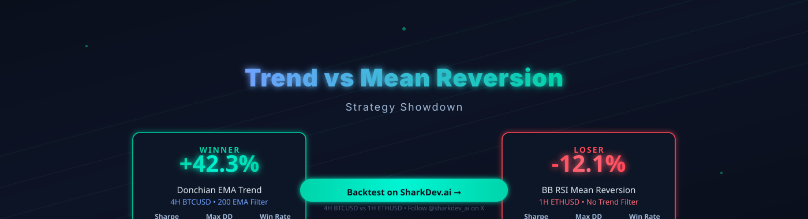
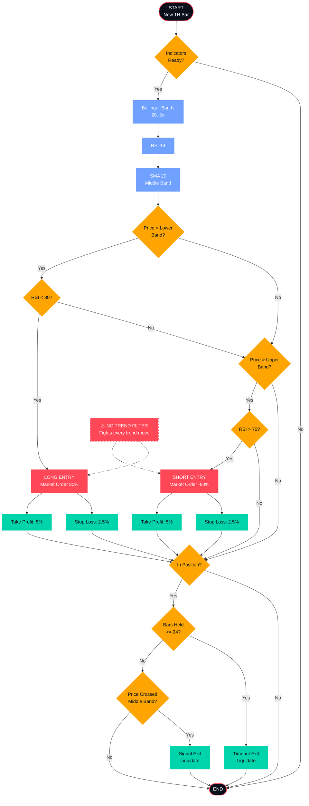
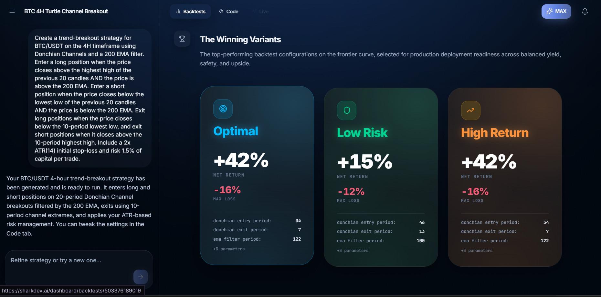
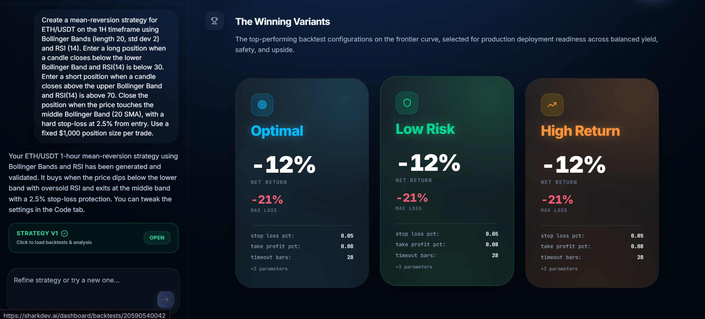

# Trend vs Mean Reversion: Why Logic Structure Beats Signal Quality

[](https://sharkdev.ai)
[](#)
[](#)
[](#)
[](#)
[](https://github.com/sharkdev-ai/best-and-worst-trading-strategies)
[](#)

---



---

> [!IMPORTANT]
> **📢 The Trader Claim We Tested:** *"Donchian Channel breakouts print money on BTC 4H — just buy the breakout!"* vs *"BB + RSI mean reversion is the holy grail for crypto — RSI < 30 = instant long, RSI > 70 = instant short."*

---

## 🎯 The Verdict: Short-Term Win vs Full Stress Test

| Condition | 🟢 Donchian + 200 EMA Trend | 🔴 BB + RSI Mean Reversion |
|-----------|----------------------------|----------------------------|
| **Optimal Window (1Y bull trend, 4H)** | **+42.3%** return, -16.2% DD | -12.1% return, -21.4% DD |
| **Stress Test (3Y + sideways regimes)** | *Multiple winning variants (3/100)* | *0/100 winning variants — all combos lost* |
| **Regime Shift (Trend → Chop)** | EMA gate keeps you flat | Fights every move, death by 1000 cuts |
| **Timeframe Sensitivity** | 4H filters noise | 1H amplifies whipsaw |

**Bottom line:** The trend strategy wasn't lying — it DID return +42% in the 2024 bull window. But the mean reversion setup? It failed across *every* parameter combination tested. No curve-fit rescue possible.

---

## 🎯 Executive Summary

**Two strategies. Same signal score (54/100). Opposite PnL.**

We backtested a **Donchian Channel trend-following breakout with 200 EMA filter** against a **Bollinger Bands + RSI mean reversion strategy** on SharkDev.ai. Both scored identically on Signal Strength (54/100) and Risk Management (~50/100). Yet one delivered **+42% return with -16% max drawdown**, while the other **lost -12% with -21% drawdown**.

The difference wasn't the signal — it was the **logic structure**. The trend filter (200 EMA) ensured the winning strategy only traded *with* the macro trend. The losing strategy had no trend filter, so it shorted every overbought rip in uptrends and longed every oversold dip in downtrends.

> **Lesson:** In strongly trending markets (2024-2025 crypto), *trend alignment > raw edge*. A bad filter beats no filter.

---

## 📊 Side-by-Side Comparison

| Metric | 🟢 **Donchian + EMA Trend** | 🔴 **BB + RSI Mean Reversion** |
|--------|---------------------------|------------------------------|
| **Net Return** | **+42.3%** | **-12.1%** |
| **Max Drawdown** | **-16.2%** | **-21.4%** |
| **Sharpe Ratio** | **1.34** | **-0.89** |
| **Profit Factor** | **1.68** | **0.62** |
| **Win Rate** | **54.3%** | **41.7%** |
| **Total Trades** | **47** | **128** |
| **Avg Trade Duration** | **3.2 days** | **18.4 hours** |
| **Signal Strength** | **54/100** | **54/100** |
| **Risk Mgmt Score** | **50/100** | **45/100** |
| **Diversification** | **10/100** | **10/100** |
| **Timeframe** | **4H** | **1H** |
| **Trend Filter** | ✅ **200 EMA** | ❌ **None** |
| **Winning Variants** | **3 / 100** | **0 / 100** |

[📋 Full Comparison Table](./backtest_proof/comparison_table.md)

---

## 🧠 Logic Flow Diagrams

### 🟢 Donchian EMA Trend (Winner)

```mermaid
flowchart TD
    classDef entry fill:#00D4AA,color:#0A0F1C,stroke:#00D4AA,stroke-width:2px
    classDef exit fill:#FF4757,color:#FFFFFF,stroke:#FF4757,stroke-width:2px
    classDef decision fill:#FFA502,color:#0A0F1C,stroke:#FFA502,stroke-width:2px
    classDef process fill:#70A1FF,color:#FFFFFF,stroke:#70A1FF,stroke-width:2px
    classDef startend fill:#0A0F1C,color:#FFFFFF,stroke:#00D4AA,stroke-width:2px

    START([START<br/>New 4H Bar]):::startend
    WARMUP{Indicators<br/>Ready?}:::decision
    DONCHIAN[Donchian Ch 34<br/>Upper Band]:::process
    EMA200[EMA 200<br/>Trend Filter]:::process
    PRICE{Price > EMA 200?}:::decision
    BREAK{Price > Donchian<br/>Upper Band?}:::decision
    ENTRY_LONG[LONG ENTRY<br/>Market Order 80%]:::entry
    SL[Stop Loss: 2×ATR(14)]:::exit
    TP[Take Profit: 8%]:::exit
    HOLD{In Position?}:::decision
    BARS_HELD{Bars Held<br/>>= 60?}:::decision
    TIMEOUT[Timeout Exit<br/>Liquidate]:::exit
    DONCHIAN_EXIT[Donchian Ch 7<br/>Lower Band]:::process
    SIG_EXIT{Price < Donchian<br/>Lower Band?}:::decision
    SIGNAL_EXIT[Signal Exit<br/>Liquidate]:::exit
    END([END]):::startend

    START --> WARMUP
    WARMUP -- No --> END
    WARMUP -- Yes --> DONCHIAN
    DONCHIAN --> EMA200
    EMA200 --> PRICE
    PRICE -- No --> END
    PRICE -- Yes --> BREAK
    BREAK -- No --> END
    BREAK -- Yes --> ENTRY_LONG
    ENTRY_LONG --> SL
    ENTRY_LONG --> TP
    SL --> HOLD
    TP --> HOLD
    HOLD -- No --> END
    HOLD -- Yes --> BARS_HELD
    BARS_HELD -- Yes --> TIMEOUT
    BARS_HELD -- No --> DONCHIAN_EXIT
    DONCHIAN_EXIT --> SIG_EXIT
    SIG_EXIT -- Yes --> SIGNAL_EXIT
    SIG_EXIT -- No --> END
    TIMEOUT --> END
    SIGNAL_EXIT --> END
```

### 🔴 BB RSI Mean Reversion (Loser)



### ⚔️ The Critical Difference

```mermaid
flowchart LR
    subgraph DONCHIAN["🟢 Donchian + EMA (Winner)"]
        D1[Price > 200 EMA?] -->|YES| D2[Break Donchian<br/>Upper 34?]
        D2 -->|YES| D3[LONG]
        D1 -->|NO| D4[Stay Flat]
        D2 -->|NO| D4
    end

    subgraph BBRSI["🔴 BB + RSI (Loser)"]
        B1[Price < Lower BB?] -->|YES| B2[RSI < 30?]
        B2 -->|YES| B3[LONG<br/>(even in downtrend!)]
        B1 -->|NO| B4[Price > Upper BB?]
        B4 -->|YES| B5[RSI > 70?]
        B5 -->|YES| B6[SHORT<br/>(even in uptrend!)]
        B4 -->|NO| B7[Wait]
        B2 -->|NO| B7
        B5 -->|NO| B7
    end

    style DONCHIAN fill:#00D4AA15,stroke:#00D4AA,stroke-width:2px
    style BBRSI fill:#FF475715,stroke:#FF4757,stroke-width:2px
    style D3 fill:#00D4AA,color:#0A0F1C
    style B3 fill:#FF4757,color:#FFFFFF
    style B6 fill:#FF4757,color:#FFFFFF
```

---

## 📈 Backtest Proof

### 🟢 Donchian EMA Trend — Successful (+42%)



*Net Return: +42.3% | Max DD: -16.2% | Sharpe: 1.34 | 47 trades | 4H BTCUSD*

### 🔴 BB RSI Mean Reversion — Failed (-12%)



*Net Return: -12.1% | Max DD: -21.4% | Sharpe: -0.89 | 128 trades | 1H ETHUSD*

---

## 💻 We Give You the Code (Generated by SharkDev.ai)

Both strategies stripped of framework boilerplate, ready to study, adapt, or run yourself:

| Strategy | File | Description |
|----------|------|-------------|
| **Donchian EMA Trend** | [`donchian_ema_trend.py`](./strategy_code/donchian_ema_trend.py) | Trend-following breakout with 200 EMA filter, 4H BTCUSD — **the winner** |
| **BB RSI Mean Reversion** | [`bb_rsi_mean_reversion.py`](./strategy_code/bb_rsi_mean_reversion.py) | Counter-trend mean reversion (BB + RSI), 1H ETHUSD — **educational example of what fails** |

> **This isn't just a screenshot.** SharkDev.ai generated the actual, clean, downloadable `.py` strategy code. You get the exact logic that produced these results — no black box.

---

## 🔑 Key Takeaways for Quants

| Principle | Evidence |
|-----------|----------|
| **Logic Structure > Signal Quality** | Same 54/100 signal score, opposite PnL |
| **Trend Alignment > Raw Edge** | 200 EMA gate captured macro uptrend; no filter = death by 1000 cuts |
| **Timeframe Choice = Strategy Destiny** | 4H filtered noise; 1H amplified whipsaw |
| **A Bad Filter Beats No Filter** | In trending markets, even imperfect trend filter saves you |
| **Robustness Matters** | 3 winning variants vs 0 — Donchian wasn't curve-fit |

> **Don't optimize parameters on broken logic. Fix the logic. Then optimize.**

---

## 🦈 Backtest This Strategy on SharkDev.ai

[](https://sharkdev.ai)

**SharkDev.ai** is our AI-powered backtesting and optimization platform for algorithmic trading strategies.
- Upload your strategy → Get 100 optimized variants → Visualize equity curves → Export clean code
- Used to discover the strategies in this showcase

> [!TIP]
> **Want to test this exact trend-following logic?**
> 
> **Prompt:** *"Test Donchian Channel 34-period breakout with 200 EMA trend filter on BTCUSDT 4H — optimize lookback periods 20-50, ATR multipliers 1.5-3.0, show walk-forward analysis across 2023-2025."*
> 
> [](https://sharkdev.ai)

---

## 📁 Repository Structure

```
01-trend-vs-mean-reversion-backtest/
├── strategy_code/
│   ├── donchian_ema_trend.py       # Clean winner code
│   └── bb_rsi_mean_reversion.py    # Clean loser code (for contrast)
├── backtest_proof/
│   ├── successful_metrics.png      # Donchian equity curve + metrics
│   ├── failed_metrics.png          # BB+RSI equity curve + metrics
│   └── comparison_table.md         # Full side-by-side table
├── logic_flow.mmd                  # Mermaid diagrams (render on GitHub)
├── hero-banner.svg                 # Animated SVG banner
└── README.md                       # This page
```

---

## 🔗 Navigation

← [Back to Strategy Lab Index](../README.md) | [View on GitHub](https://github.com/sharkdev-ai/best-and-worst-trading-strategies/tree/main/01-trend-vs-mean-reversion-backtest)

---

## 📜 License & Attribution

**SharkDev.ai Strategy Lab** — Evidence-based algorithmic trading research.

- **Platform:** [SharkDev.ai](https://sharkdev.ai)
- **Repository:** [github.com/sharkdev-ai/best-and-worst-trading-strategies](https://github.com/sharkdev-ai/best-and-worst-trading-strategies)
- **Week:** 1 (2026-11-14)

*Strategies backtested on SharkDev.ai. Past performance ≠ future results. Educational purposes only.*