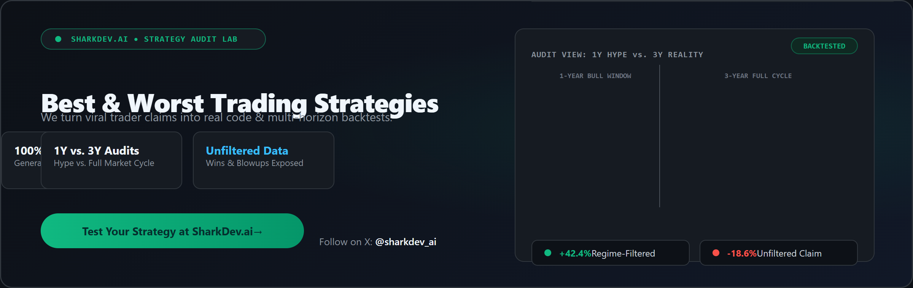

<p align="center"><a href="https://sharkdev.ai"></a></p>

**Evidence-Based Algorithmic Trading Research**

[](https://github.com/sharkdev-ai/best-and-worst-trading-strategies)
[](#showcase)
[](https://sharkdev.ai)
[](LICENSE)

[](https://x.com/sharkdev_ai)
[](https://sharkdev.ai)

</div>

---

## 🎯 Mission

We publish **weekly strategy showdowns** that compare real backtested strategies side-by-side — winners and losers — with full code, logic flows, and metric extraction. No curve-fitting. No hidden failures. Just evidence.

> **Core Principle:** *Logic Structure > Signal Quality* — Same signal score, opposite PnL.

---

## 📊 Showcase

| # | Project | Strategies | Winner | Loser | Key Insight |
|---|---------|------------|--------|-------|-------------|
| 01 | [Trend vs Mean Reversion Backtest](01-trend-vs-mean-reversion-backtest/) | **2** | Donchian EMA Trend **(+42.3%)** | BB RSI Mean Reversion **(-12.1%)** | Trend filter (200 EMA) saved the winner; no filter killed the loser |

---

## 🏗️ Repository Structure

```
best-and-worst-trading-strategies/
├── 01-trend-vs-mean-reversion-backtest/   # Public showcase #1
│   ├── strategy_code/                     # Clean, commented code (winner + loser)
│   ├── backtest_proof/                    # Screenshots + metrics tables
│   ├── logic_flow.mmd                     # Mermaid.js logic flowchart
│   ├── hero-banner.svg                    # Project-specific animated banner
│   └── README.md                          # Self-contained project page
├── assets/
│   └── hero-banner.svg                    # Site-wide animated banner
├── README.md                              # This landing page
└── LICENSE                                # MIT License
```

---

## 🔬 Research Methodology

| Step | Description |
|------|-------------|
| **1. Input** | Strategies arrive in numbered input folders (1–10) |
| **2. Screenshot Analysis** | **Mandatory** — visually inspect every result, extract all metrics |
| **3. Classification** | Winner/Loser based on screenshot metrics (primary), cross-checked with code |
| **4. Documentation** | `analysis.md` per strategy with full metric extraction |
| **5. Public Content** | One showcase folder per research piece with code, proof, flow, banner |

---

## 📈 Key Metrics We Track

| Metric | Purpose |
|--------|---------|
| **Net PnL** | Absolute return over backtest period |
| **Max Drawdown** | Worst peak-to-trough decline |
| **Sharpe Ratio** | Risk-adjusted return |
| **Profit Factor** | Gross profit / gross loss |
| **Win Rate** | % of winning trades |
| **Total Trades** | Sample size for statistical validity |
| **Winning Variants** | Robustness across parameter permutations |

---

## 🚀 Get Started

### Backtest Your Own Strategies

[](https://sharkdev.ai)

**SharkDev.ai** — AI-powered optimization for algorithmic trading strategies. Upload your code, get parameter optimization, walk-forward analysis, and robustness testing.

> [!TIP]
> **Want to see how your strategy stacks up?**
> 
> **Prompt:** *"Analyze my strategy on BTCUSDT 4H timeframe with 2-year lookback — show me parameter optimization, walk-forward windows, and Monte Carlo robustness."*
> 
> [](https://sharkdev.ai)

### Follow Weekly Showdowns

- 🐦 **X/Twitter:** [@sharkdev_ai](https://x.com/sharkdev_ai) — Weekly threads with strategy breakdowns
- 📁 **GitHub:** Watch this repo for new showcase folders
- 🧠 **Platform:** [SharkDev.ai](https://sharkdev.ai) — AI-powered strategy optimization

---

## 📜 License

MIT License — see [LICENSE](LICENSE) for details.

---

<div align="center">

**Built with evidence. Published with transparency.**

[](https://sharkdev.ai)

</div>